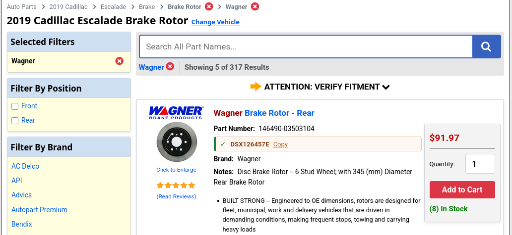
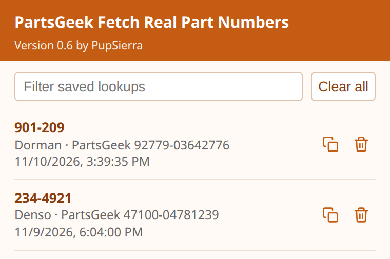

THIS IS NOW IN THE OFFICIAL MOZILLA EXTENSION STORE, PLEASE DOWNLOAD IT HERE: https://addons.mozilla.org/en-US/firefox/addon/pg-fetch-real-pn/

This way you can install it properly in a couple clicks and not have to reinstall it manually each time you open your browser.

# PartsGeek Fetch Real Part Numbers

A Firefox add-on that shows the real manufacturer part number on [PartsGeek](https://www.partsgeek.com) listings and remembers past lookups.

**I am not affiliated with PartsGeek.** This add-on is an independent project and is not endorsed by, associated with, authorized by, or approved by PartsGeek.

## What it does

PartsGeek catalog pages show their own SKU (for example `Dorman 92779-03642776`). The first half changes per vehicle; the last 8 digits (`03642776`) identify the product.

For each listing, the add-on searches PartsGeek's own site search for those 8 digits. Search result cards carry the manufacturer's number (for example `Dorman 901-209` or `Denso 234-4921`). Only result cards whose SKU ends in the same 8 digits are trusted, because the search is fuzzy.

On product detail pages (such as `/1x6h3ms-ford-explorer-liftgate-release-switch.html`) the number is read straight from the page title, with no extra requests.

Successful lookups are saved in Firefox on this computer and reused the next time. Click the toolbar icon to view, filter, copy, or clear saved lookups.

Some listings have no manufacturer number on PartsGeek at all (they only carry a warehouse code like `W0133-2097268`). Those show "Failed to fetch" with a Google it link.

If PartsGeek's Cloudflare check blocks the search, listings show "Security check". Click **Open check**, finish the check in the new tab, then click **Try again** on any listing to retry them all.

## Screenshots

Manufacturer part numbers appear on PartsGeek listings, with a copy button:

The toolbar popup lists saved lookups so you can filter, copy, or clear them. Each row shows the brand in front of the part number:

## Install in Firefox as a temporary add-on

This add-on is not published on [addons.mozilla.org](https://addons.mozilla.org), so Firefox will not install it the way it installs signed extensions from the store. Instead, you load it yourself as a **temporary add-on**.

Temporary add-ons are a built-in Firefox feature for loading an unpacked extension from a folder on your computer:

- You do not need Firefox Developer Edition or Nightly. Regular Firefox works.
- You do not need to disable extension signing or change hidden settings.
- Firefox does not permanently install the add-on, does not sync it to other devices, and does not keep it after you quit the browser.
- When you restart Firefox, the add-on is unloaded. Load it again the same way if you want to keep using it.
- Each time you load it, Firefox uses the files in the folder you selected, so updates are just a matter of updating those files and loading it again.

### Enable it

1. Download or clone this repository and keep the folder somewhere you will not delete it, such as your Documents folder.
2. In Firefox, type `about:debugging` in the address bar and press Enter.
3. Click **This Firefox** in the left sidebar.
4. If an older version of this add-on is already listed, click **Remove** next to it first.
5. Click **Load Temporary Add-on...**
6. Open the repository folder and select `manifest.json`.

The add-on should appear in the list on that page and in your Firefox toolbar. Open a PartsGeek catalog or product page and manufacturer part numbers should start appearing on listings.

The official Mozilla instructions for this process are here: [Temporary installation in Firefox](https://extensionworkshop.com/documentation/develop/temporary-installation-in-firefox/).

## Permissions

The add-on asks for:

- Access to `partsgeek.com` and `www.partsgeek.com`, so it can read listings and search for manufacturer numbers
- Storage, so it can remember successful lookups on this computer

It does not need access to other websites.

## License

This project is licensed under the [MIT License](LICENSE).
